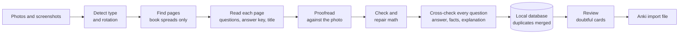

# QB to Anki

**Turn photos and screenshots of MCQ question banks into clean, study-ready Anki flashcards.**

QB to Anki reads multiple-choice questions from book photos, PDF pages and web screenshots, checks what it read, fills the gaps
with AI, and exports one file you import into [Anki](https://apps.ankiweb.net/). It is built for Bangladeshi job-exam
preparation (BCS, bank and government recruitment exams), handles Bangla and English side by side, and runs entirely on your own
Windows PC. The only thing that leaves your computer is the page images, sent to Google's Gemini API with your own key.


---

## Features

- **Reads any source.** Detects by itself whether a photo is a two-page book spread, a single page or a screenshot, and turns it
  upright. Portrait, landscape and sideways photos all work.
- **Understands question-bank layouts.** Answer-key tables, answers printed next to each question (`উত্তর: ঘ`, `উ.ক`), answer
  lines for many questions, ক/খ/গ/ঘ or A/B/C/D options, worked solutions (`ব্যাখ্যা`, `সমাধান`) and figures.
- **Proofreads every page against the photo.** Fixes misread Bengali letters and digits (৪ read as 8, ৭ read as 9), broken
  formulas and ditto marks in worked solutions, while keeping the first reading for comparison.
- **Checks the math.** Every formula is tested so it renders in Anki; the AI repairs formatting and confirms the working reaches
  the answer, and re-reads the picture when a solution is still broken.
- **Cross-checks every question.** A text-only AI check solves each question itself, compares with the source's answer, spots
  outdated facts and wrong explanations, and repairs damaged text by matching it to the known MCQ. You choose whether
  disagreements wait for you, are corrected automatically when the AI is sure, or only add a note.
- **Fills gaps, clearly labelled.** Works out answers the source does not give and writes short explanations where there are
  none. AI answers are marked on the card and tagged `Answer::AI`.
- **Nothing reaches Anki silently.** Anything doubtful is held for review, shown next to its photo.
- **Merges duplicates** across books and exams and remembers every exam a question appeared in.
- **Study-friendly cards** with light and night mode, decks per subject and exam tags.
- **One local app controls everything**: reading, review, export, settings, keys, backups.
- **Safe with your data**: automatic backups before every task, saved AI answers so nothing is paid for twice.

## How it works



Every step that can be wrong produces a flag. Cards with a **must check** flag wait in Review until you approve them; cards with
only a **note** are exported. See [docs/ARCHITECTURE.md](docs/ARCHITECTURE.md) for the full design.

## Quick start

**Requirements:** Windows 10 or 11, [Python 3.12](https://www.python.org/downloads/) (3.11 and 3.13 also work; 3.14 and newer
do not yet), a free [Gemini API key](https://aistudio.google.com/apikey), and Anki 2.1.54 or newer.

1. Download this repository (**Code → Download ZIP**) and unzip it to a short local folder such as `C:\QB2Anki`.
2. Double-click **`setup.bat`** (one time; installs everything into a private environment).
3. Double-click **`start.bat`**. The app opens in your browser at `http://127.0.0.1:8765`.
4. Open **Settings**, paste your Gemini API key, press **Save key**, then **Check setup**.

Every day after that:

| Step | In the app |
|---|---|
| 1. Add | **Read photos**: drop your photos in. Reading starts by itself. |
| 2. Check | **Review**: compare doubtful cards with their photo, press **Ctrl+Enter** to approve. |
| 3. Export | **Export to Anki**: create the file, then **File → Import** in Anki. |

The full walkthrough, settings reference and troubleshooting table are in the **[User guide](docs/USER_GUIDE.md)**.

## Requests and free quotas

Free Gemini keys allow a limited number of requests per model per day (check yours at <https://ai.dev/rate-limit>).

| Source | Requests per image (approx.) |
|---|---|
| Book spread (two pages, ~25 questions) | about 10: detect, find pages, read and proofread 2 pages, cross-check 4 batches |
| Screenshot or single page (~10 questions) | about 4: detect, read, proofread, cross-check |
| Math check | a few more for worked math solutions |

When a quota runs out the app stops cleanly, keeps all finished work and tells you when to continue. Fallback models are tried
automatically when one is busy or used up. Choosing the photo type yourself, or turning proofreading or the cross-check off,
saves requests. **Settings → Which key to use** switches between one key (for example a paid key) and rotation through a key list.

## Project structure

```
qb2anki/
├── qb2anki/            the application
│   ├── pipeline.py     reading pipeline (detect, layout, read, proofread, math, fill, store)
│   ├── gemini_client.py  Gemini calls: caching, retries, fallback models, optional key rotation
│   ├── assemble.py     turns a page reading into validated questions with flags
│   ├── proofread.py    AI proofreading against the page picture
│   ├── mathcheck.py    formula lint, free tidy-up, AI math check and re-read
│   ├── factcheck.py    full text-only cross-check of every question
│   ├── fill.py         AI answers and explanations for gaps (when the cross-check is off)
│   ├── db.py           SQLite storage, duplicate merging, migrations
│   ├── export_anki.py  Anki import file and card design
│   ├── ui.py, web/     the local app (server and screen)
│   └── ...
├── tests/              automated tests (no API key or internet needed)
├── docs/               user guide and architecture
├── config.toml         default settings
├── setup.bat           one-time installation
└── start.bat           opens the app
```

## Running the tests

```bash
pip install -r requirements.txt
python -m unittest discover -s tests
```

The tests (about 100) replace Gemini with a fake, so they need no key or internet. They can also be run on GitHub for Windows and
Linux with Python 3.11 to 3.13 from the **Actions** tab (**Tests → Run workflow**). If the `anki` package is installed
(`pip install anki`), the export tests also import the generated file with Anki's own import engine.

## Privacy and security

- The app listens only on `127.0.0.1` and every request needs a per-session token, so other websites cannot control it.
- Your API key is stored in a local `.env` file. Keys are never written to the database, the log or the debug bundle.
- `.env`, `keys.txt`, `settings.json`, your photos and your database are excluded from git by `.gitignore`.

See [SECURITY.md](SECURITY.md) for how to report a problem.

## Important notes

- **AI output must be checked.** Answers and explanations written by the AI are guesses, especially for Bangladesh-specific facts
  and recent events. They are always labelled so you can review them.
- **The cross-check knows facts only up to the AI model's training date**, so very recent changes can still be missed.
- **Key rotation is optional and at your own risk.** The app can spread requests over several API keys, but Google's terms do not
  allow using multiple projects to get around quotas, and projects have been restricted for it. Read the
  [user guide](docs/USER_GUIDE.md#6-free-quotas-fallback-models-and-key-rotation) first.
- **Respect copyright.** Use the tool for your own study material.

## Contributing

Bug reports and suggestions are welcome; please open an issue. For code changes, see [CONTRIBUTING.md](CONTRIBUTING.md).

## Changelog

See [CHANGELOG.md](CHANGELOG.md).
